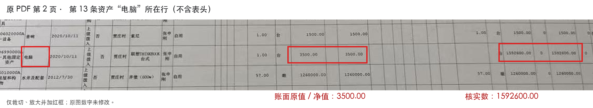

# 贾庄村三资公示资料

整理河南省南阳市镇平县张林镇贾庄村的集体资金、资产、资源公示资料，以及相关会议截图和核对意见。本仓库保存截至2026年10月26日收到的材料，由个人整理，非村方官方发布渠道。

原始公示与会议材料保留在独立目录。核对意见列明已发现的账表异常和需要进一步说明的事项；其中待核实的问题不代表已经查明存在资金损失。

## 最新修正表核对（2026年10月26日）

新收到的[非经营性资产修正表](updates/2026-10-26-corrected-assets/原始文件/2非经营性资产清查表.xlsx)已将电脑核实原值、净值从1592600元改回3500元。本表57项资产合计也同步由11475842元改为9886742元，减少1589100元，逐项加总及公式保存结果均一致。原公示继续保留；本次未收到其他资产汇总表及正式更正说明。

- [新旧版本核对结果](updates/2026-10-26-corrected-assets/核对结果.txt)
- [57项金额逐项对照](updates/2026-10-26-corrected-assets/金额逐项对照.json)

日期先后、折旧依据和统计表“增加数量14个”的口径与前后明细仍待说明；修正表还保留原公示已有的资产分类错配。非经营性资产部分现已取得清晰电子表，其他清查表仍待补充。前次将一条空调辨读为“挂机”有误，原图及新表均为柜机，本次更正。

核查范围更正：同型号、同价的打印机和空调有多条记录，本身不足以说明异常，现有材料没有证明重复登记；该项退出重点问题清单，历史Issue保留更正说明。统计表原文是“增加数量（个）14”，未直接写新购14件或14条新增记录，应先确认统计口径。

## 原高优先级问题复审

按原始文件和修正表重新审查后，[电脑金额问题#1](https://github.com/Rabithua/jiazhuang-village-disclosure-2026/issues/1)按已纠正关闭；[总额问题#2](https://github.com/Rabithua/jiazhuang-village-disclosure-2026/issues/2)收窄为不同日期和统计范围的衔接说明，降P2；[学校问题#3](https://github.com/Rabithua/jiazhuang-village-disclosure-2026/issues/3)只保留一般权属说明请求，降P3。本轮依用户要求排除#7，没有复审或改动该项。

逐项原文位置、算式、时点及判断边界见[复审记录](reviews/2026-10-26-high-priority.txt)。此前把部分资料缺口维持为高优先级异常的判断，按本次复审更正。

## 阅读与下载

- [问题汇总：按优先顺序查看](https://github.com/Rabithua/jiazhuang-village-disclosure-2026/issues/21)
- [政策依据、官方来源与条款说明](policies/README.md)
- [20项问题与政策依据对应表](policies/02_20项问题对应依据.txt)
- [下载原始公示资料包](https://github.com/Rabithua/jiazhuang-village-disclosure-2026/releases/tag/2026-10-26)（不含后续政策补充）
- [初始六条反馈意见](materials/04_整理文本/01_反馈意见_可直接复制.txt)（状态以最新复审及Issue为准）
- [问题与来源索引](materials/04_整理文本/02_问题与来源索引.txt)
- [已核对数字与统计范围](materials/04_整理文本/03_已核对数字与范围.txt)
- [文件来源及SHA-256清单](materials/文件清单.json)

## 资料组成

| 目录 | 内容 |
| --- | --- |
| [原始PDF](materials/01_原始PDF) | 3份，共28页，保留原始文件名和文件字节 |
| [原始截图](materials/02_原始截图) | 4张，按议题及会议详情更名，图像文件内容未修改 |
| [重点页与标注图](materials/03_重点页与标注图) | 9张，含电脑金额定位图及PDF重点页图像 |
| [整理文本](materials/04_整理文本) | 最终反馈意见、来源索引、已核对数字与范围说明 |
| [政策依据](policies) | 河南省、南阳市、镇平县的官方文件来源、条款说明、20项问题对应表及省办法原始PDF |
| [后续修正表](updates/2026-10-26-corrected-assets) | 10月26日收到的原始xlsx、57项金额对照、核查说明及独立校验清单 |

截图原始文件名、导出图对应的源PDF和页码均记录在[文件清单](materials/文件清单.json)中。所有页码指PDF阅读器中从第一页开始的顺序页码。

## 主要核对事项及当前状态

1. 已纠正：原公示电脑核实数为1592600元，新表已改回3500元，本表合计也同步修正为9886742元。#1关闭，其他总表范围与时点的对应留给#2。
2. 待说明：9月统计资产1146.14万元与10月说明1149.1567万元相差30167元，但不能直接假定两表同一基准日和范围。请说明各自统计截止日、范围和增减，并与修正表衔接；不要求不同日期的总数必须相同。
3. 一般资料补充：请说明贾庄小学及该校广场的权属与入账主体。目前没有材料证明其必属村集体、曾入村账或本次被违规核减；这里不涉及其他文化广场。
4. 统计表“增加数量（个）14”及5个问题已整改的表述，需要说明数量口径、前后明细和逐项整改结果；不能把14直接解释为新购14件资产。
5. 发包方案中的特殊情况下签订超低价合同，需要明确适用条件、价格依据和监督程序。
6. 非经营性资产部分已收到清晰电子表；其他公示表照片模糊、裁切及重页问题仍待补充完整版本。

以上为初始六条反馈。后续逐项核查已整理为[问题清单及优先顺序](https://github.com/Rabithua/jiazhuang-village-disclosure-2026/issues/21)，具体证据和补充材料请求见各Issue；原始资料位置见[问题与来源索引](materials/04_整理文本/02_问题与来源索引.txt)。

## 政策依据补充

截至2026年10月26日，已核对下列直接相关依据，完整来源、适用范围和检索限制见[政策目录](policies/README.md)：

- 《河南省社会治理条例》第23条：村级重要事项实行“四议两公开”，2025年12月1日起施行。
- 《河南省农村集体财产管理办法（试行）》：2025年5月1日起施行，南阳市以宛农通〔2025〕19号转发；涉及民主决策、年度清查、资产台账、资金凭证、合同公开及归档备案。仓库保存[官方原始附件](policies/03_河南省农村集体财产管理办法_官方原始附件.pdf)。
- 镇政〔2016〕4号《镇平县农村基层财务管理办法（试行）》及镇政〔2025〕5号继续有效目录：提供本地财务、资源和核销程序依据，须与现行上位法及新省办法衔接。
- 2026年省委、省政府乡村振兴实施意见，以及4月全省“三资”清查整治推进会、10月省纪委相关部署：提供本轮整治的政策背景和核查方向。

正式法规、管理文件与部署报道分别标明；地方实践不作为全省统一细则。每项问题对应的条款和资料请求列在[对应表](policies/02_20项问题对应依据.txt)，相关Issue另附依据链接。省级专项行动方案完整正文、具体签到照归档规则及本村定价依据等尚未取得的材料，均明确列为待补充。

## 电脑金额定位

以下为旧版定位，保留用于版本对照。位于22页清查PDF第2页、第13条资产记录，名称为“电脑”。左侧框为账面原值、净值3500.00元；右侧框为核实原值、净值1592600.00元。新收到表第19行已经改回3500元。



[查看整页定位图](materials/03_重点页与标注图/01_电脑金额_整页标注.png) · [查看未加标注的导出原图](materials/03_重点页与标注图/03_清查表第2页_原图导出.png)

标注图仅裁切、放大、旋转或添加说明及红框，没有替换原图数字。照片本身模糊或未拍到的内容无法通过放大恢复。

## 文件完整性

原始PDF和截图已逐文件核对字节内容。仓库中的[SHA256SUMS.txt](materials/SHA256SUMS.txt)记录资料包内其他21个文件的SHA-256。

政策目录及[后续修正表目录](updates/2026-10-26-corrected-assets/文件清单.json)分别使用独立文件清单和SHA-256校验表，不改变原始公示资料的清单和校验值。在仓库根目录运行以下命令，可使用Python 3标准库验证三个目录的全部归档文件：

```bash
python3 scripts/verify_materials.py
```

发布页的原始公示资料包与最初整理的ZIP一致，SHA-256为：

```text
8b8fce8c929f246bdfb80245b3a0cfc4883521a9b0629b211dc192222b03c83b
```

校验值用于核对文件之后是否发生字节变化，不用于证明公示内容本身真实。

## 后续更正

如收到更正公示、原始电子表格、产权或整改说明，应保留既有版本，并注明新材料的日期、来源和对应修改内容。对当前材料的核对仍以原始文件及后续正式说明为依据。
